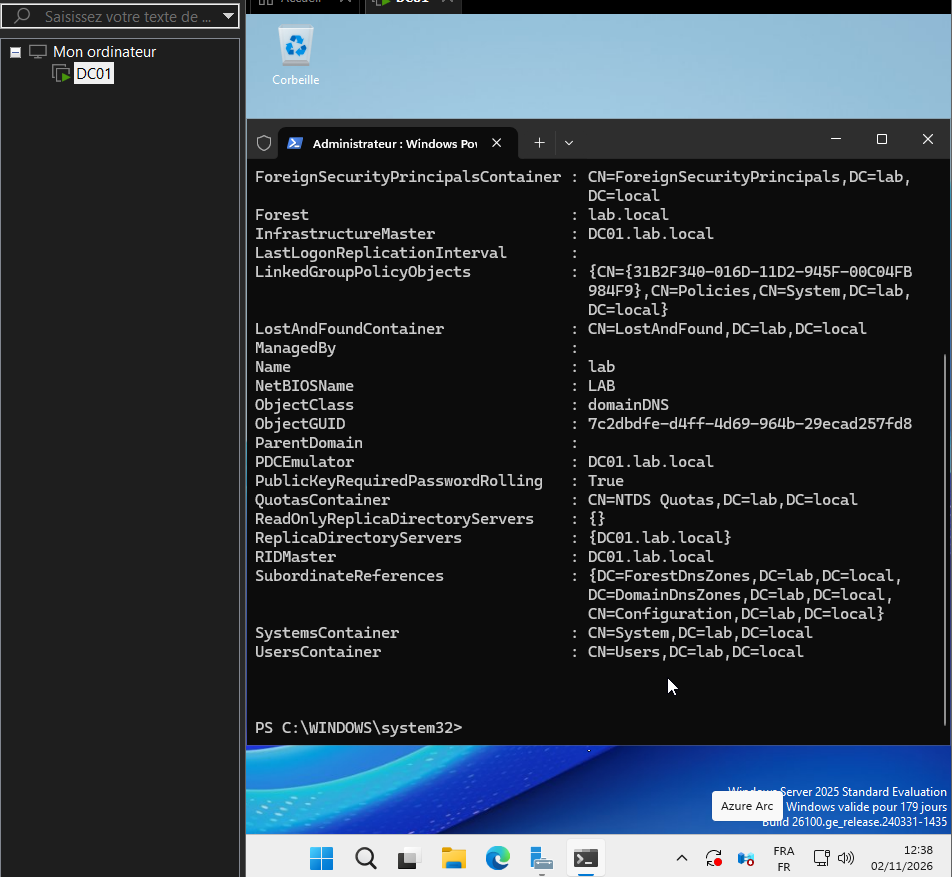

#
# Script Windows PowerShell pour le déploiement d’AD DS
#

Import-Module ADDSDeployment
Install-ADDSForest `
-CreateDnsDelegation:$false `
-DatabasePath "C:\WINDOWS\NTDS" `
-DomainMode "Win2025" `
-DomainName "lab.local" `
-DomainNetbiosName "LAB" `
-ForestMode "Win2025" `
-InstallDns:$true `
-LogPath "C:\WINDOWS\NTDS" `
-NoRebootOnCompletion:$false `
-SysvolPath "C:\WINDOWS\SYSVOL" `
-Force:$true

