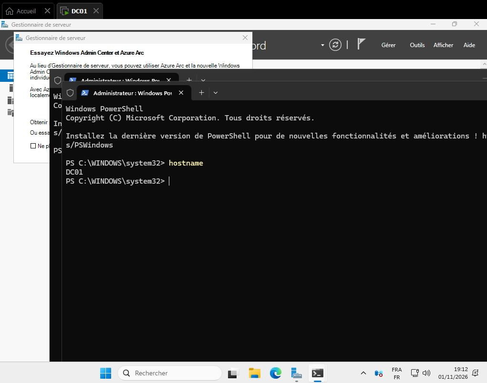

# Jour 1 – Mise en place du laboratoire

## Objectif
Préparer l'environnement de virtualisation et installer le futur contrôleur de domaine.

## Configuration
| Élément | Valeur |
|---|---|
| Hôte | Windows 11 Famille, Intel Core i5 11e gén., 16 Go |
| Hyperviseur | VMware Workstation Pro (gratuit) |
| VM | DC01 – Windows Server 2025 Standard Evaluation (Expérience de bureau) |
| Ressources | 2 vCPU, 3 Go de mémoire, disque NVMe 60 Go (alloué dynamiquement) |
| Réseau | NAT |

## Problèmes rencontrés et solutions
1. **Échec du démarrage de la VM** : « Impossible de créer un fichier de pagination anonyme pour 4096 Mo ».
   - Diagnostic : 9,6 Go de mémoire déjà utilisés sur l'hôte.
   - Solution : fermeture des applications inutiles, mémoire de la VM réduite à 3 Go, échange (swap) autorisé dans VMware.
2. **Démarrage sur le Boot Manager UEFI** au lieu de l'ISO.
   - Solution : sélection manuelle du lecteur CD-ROM puis « Press any key ».
3. **Installation en Server Core par erreur** (menu SConfig, sans interface graphique).
   - Solution : réinstallation avec l'édition « Expérience de bureau » (démarrage forcé via « Power On to Firmware »).

## Ce que j'ai appris
- Un disque virtuel dynamique n'occupe que l'espace réellement utilisé.
- La différence entre Server Core et Expérience de bureau.
- Prendre un instantané (snapshot) avant chaque étape importante.

